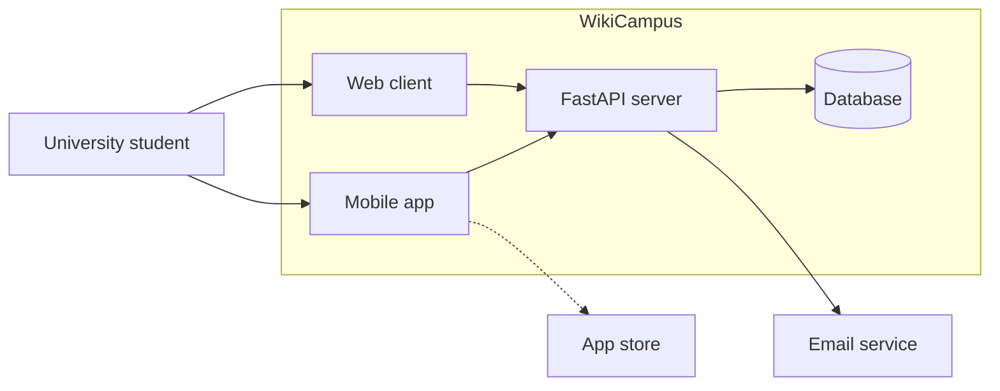

# Project Proposal

## Part A — What you will build (Week 2)

### 1. Title (about 80 characters)
WikiCampus — study resources, discussions, and course groups

### 2. One-paragraph summary (about 400 characters)
WikiCampus is a mobile and web space for university students who want to study with classmates taking the same courses. Students can share notes, ask and answer course questions, look at study profiles, and make course groups with a chat. It starts with a few practical study tools and does not replace the university's official learning system.

### 3. Problem (about 600 characters)
When students prepare for an exam, useful notes and explanations can be spread across old chat messages, personal folders, and separate course groups. Someone who misses a class may ask the same question in several chats and still not find a clear answer. During the Week 4 prototype review, my classmate said the post flow worked but every discussion opened the same sample page. They also noticed the resource search only has fixed examples. That feedback showed me that the project needs one place for finding study material and talking about it.

### 4. Solution (about 600 characters)
A student signs in with a code sent by email, searches shared study materials, and opens course discussions to read replies or write a post. Students can view study interests on profiles and create or join a course group to chat with classmates. The web client is useful for browsing and writing, while the mobile client keeps the same main flow available between classes. WikiCampus does not store grades, replace the university learning system, or offer paid tutoring.

### 5. How it works (about 600 characters + one diagram)
Students use the mobile app and web client to browse resources, discuss courses, and manage study groups. The server checks login codes and stores posts, profiles, groups, and messages in a database when those features are implemented. An email service sends the one-time code, and a public app store distributes the mobile client. AI helps me while developing this course project, but there is no AI feature inside WikiCampus.

### 6. Technologies (about 300 characters)
Mobile: Android client, final framework to be confirmed before implementation. Web: the HTML prototype in week04/prototype. Server: FastAPI and Python. Database: relational database, selected during implementation. Login email: service to be selected before Week 6. Store: public Android app store. AI: development assistant only.

### 7. Success criteria (about 400 characters)
1. A student finds a Java study resource in under two minutes.
2. A student creates a course post and another student opens it and reads its replies.
3. Three classmates create or join a course group and exchange one message each during a test session.
4. At 390 pixels wide, students can use the main mobile screens without horizontal scrolling.

---

## Part B — Why it is worth building (Week 3)

### 8. Market and target users (about 500 characters)
The first users are students in my own courses who already share notes and questions in class chats. I do not have a reliable university-wide student count, so I am treating the course groups I can reach as the first audience instead of claiming a market size I have not checked. I want to ask students in two courses how they find notes now and how often a useful answer gets lost in chat.

### 9. Competitors (about 500 characters)
1. WhatsApp or Telegram course chats are free and familiar, but old notes and answers get buried in messages.
2. Google Drive folders make it easy to share files, but discussion and group membership happen somewhere else.
3. The university learning system is the official place for course material, but informal questions and student-run study groups may not fit its course pages.

### 10. Comparison and your advantage (about 500 characters)
| Option | Find old notes | Discuss a question | Course group chat | Cost |
|---|---|---|---|---|
| Chat group | difficult | yes | yes | usually free |
| Shared drive | yes | limited | no | often free |
| University system | depends on course | limited | depends on course | already provided |
| WikiCampus | searchable resources | yes | yes | free student project |

WikiCampus keeps resources, discussions, and study groups together around the courses students already take. I still need to check whether students find this easier than switching between chat and a shared folder.

### 11. Commercial potential (about 400 characters)
This is a student project, and I do not plan to charge students. A university could choose to run it as a free peer-study tool if it proves useful. Before any real launch, someone would need to own the hosting, email costs, moderation, and student privacy work. I have not priced those parts yet.

### 12. Technical risks and how you will manage them (about 600 characters)
1. Email delivery may take longer to set up than the login screens. I will test the email service early and keep a development option for the prototype.
2. Chat and file uploads can grow beyond a short course project. I will keep the first version to text messages and resource links, with no large file uploads.
3. I chose Samsung Galaxy Store because Samsung says there is no sign-up or yearly publishing fee. I still need to apply for commercial seller status before I can distribute the app. I have not applied yet, so I will check the requirements early and keep the web client ready for demos.

## Change log
- 2026-10-24 — REQ-009 and REQ-010: added course groups and group chat to the scope, requirements, and design. Updated the proposal to keep the first release small.
- 2026-10-24 — REQ-009: chose Samsung Galaxy Store because it has no sign-up or annual publishing fee.
- 2026-10-27 — In week 5 api.md I added new API feature to match the week 6 assignment. | GET | /auth/me | — | 200 {"email":"student@example.com"} | 401 no or invalid token | REQ-001 |
- 2026-10-27 — New API future. Post-list API row.