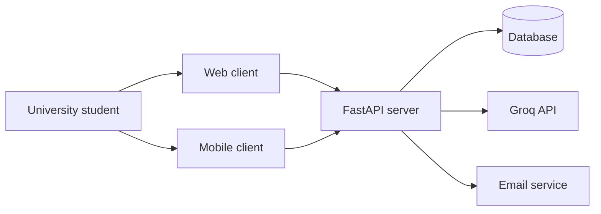

# Design — WikiCampus

## Components

| Component | What it does | REQ |
|---|---|---|
| Server: login | Sends a one-time email code and checks it before creating a session. | REQ-001 |
| Server: posts and resources | Creates discussions, shows replies, and searches shared study materials. | REQ-002, REQ-003, REQ-004, REQ-007 |
| Server: profiles | Returns a student's courses and study interests. | REQ-005 |
| Server: study groups | Creates, lists, and joins course groups and handles their chat messages. | REQ-009, REQ-010 |
| Server: chatbot | Sends WikiCampus usage questions to the Groq API; the API key stays in the server environment. | REQ-012 |
| SQLite database | Keeps discussion posts, study groups, and daily chatbot message counters in `server/wikicampus.sqlite3` across server restarts. Resources are bundled sample data. | REQ-002, REQ-003, REQ-004, REQ-009, REQ-012 |
| Web client | Lets students use WikiCampus from a laptop browser. | REQ-001, REQ-002, REQ-003, REQ-004, REQ-005, REQ-007, REQ-009, REQ-010, REQ-012 |
| Mobile client | Lets students use the same main features on a 390-pixel phone screen. | REQ-001, REQ-002, REQ-003, REQ-004, REQ-005, REQ-006, REQ-007, REQ-009, REQ-010, REQ-012 |

## Architecture

Data location: SQLite at `server/wikicampus.sqlite3` (override with `WIKICAMPUS_DATABASE`). Posts, study groups, and daily chatbot message counters are stored there so they survive a server restart.

## Change log

- 2026-11-21 — CR-04: store posts and study groups in SQLite and show the chatbot and data store in the architecture; affects `server/`, `server/.env.example`, and this design.
- 2026-11-21 — CR-05: changed the chatbot provider from OpenAI to Groq to use the free tier; affects `server/chat.py`, `server/.env.example`, and this design.
