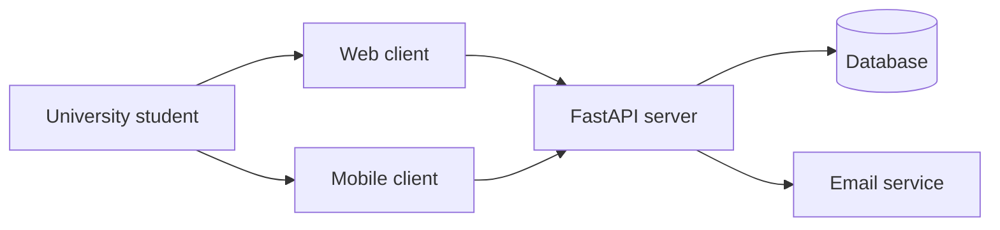

# Design — WikiCampus

## Components

| Component | What it does | REQ |
|---|---|---|
| Server: login | Sends a one-time email code and checks it before creating a session. | REQ-001 |
| Server: posts and resources | Creates discussions, shows replies, and searches shared study materials. | REQ-002, REQ-003, REQ-004, REQ-007 |
| Server: profiles | Returns a student's courses and study interests. | REQ-005 |
| Server: study groups | Creates, lists, and joins course groups and handles their chat messages. | REQ-009, REQ-010 |
| Database | Keeps student profiles, posts, replies, resources, groups, and messages. | REQ-002, REQ-003, REQ-004, REQ-005, REQ-009, REQ-010 |
| Web client | Lets students use WikiCampus from a laptop browser. | REQ-001, REQ-002, REQ-003, REQ-004, REQ-005, REQ-007, REQ-009, REQ-010 |
| Mobile client | Lets students use the same main features on a 390-pixel phone screen. | REQ-001, REQ-002, REQ-003, REQ-004, REQ-005, REQ-006, REQ-007, REQ-009, REQ-010 |

## Architecture

